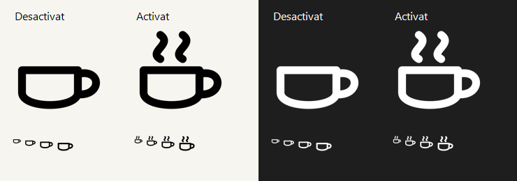

# Despert

A small, open-source Windows tray app that keeps your computer awake with one click. Portable, quiet, and written in C# with no third-party runtime packages.

[Download the latest release](https://github.com/aaronFortuno/despert/releases/latest) · [Català](docs/README.ca.md) · [Author's projects](https://aaronfortuno.github.io/portfolio/)



## Use

1. Download and extract **Despert-1.0.1-portable.zip**, then open **Despert.exe**. Requires Windows 10/11 and .NET Framework 4.8; no installation or administrator rights.
2. Click the cup near the clock to toggle. **No steam: inactive. Steam: active.** If it is hidden, drag it from the **^** tray area onto the taskbar.
3. Right-click for **Activate/Deactivate**, **Start with Windows**, **About…**, or **Exit**.

**Windows publisher notice:** the portable executable is currently unsigned, so Windows may show **Unknown publisher** or a SmartScreen warning. Version 1.0.1 does not remove that warning. See [signing status and options](docs/SIGNING.md).

Despert always opens inactive. Once activated, it stays active until you switch it off or exit. There is no timer, mode selector, or success popup. Close an older copy before opening a new version.

Optional Windows startup is unchecked by default and applies only to your user account. Keep the executable in a permanent folder before enabling it. After moving it, uncheck and recheck the option from the new copy. Windows Startup Apps settings and device policies can still disable startup. **Exit** closes the current process; uncheck startup before removing the app.

## Languages

The interface follows the **Windows display language**: English, Catalan, Spanish, Basque, or Galician. Regional variants such as `es-MX` use the corresponding language. Other languages fall back to English. No language menu is needed.

The **About** dialog contains the version, author, repository, portfolio, MIT license, and a small optional Value for Value section with a locally embedded Lightning QR. Links only open after a click, and the Lightning address is copied only when requested.

## How it works

While active, Despert asks Windows to keep the display and system awake. After 45 seconds of session inactivity, it sends a mouse movement event with **zero displacement**. Recent input postpones that event; a held mouse button prevents it. It never sends keyboard events, clicks, or wheel input.

Locking, suspension, or session disconnection pauses its effects. Unlocking or resuming restores them if the switch was still active. An error stops the active session and shows a localized error. The Windows idle counter can include software-generated input; it is not a physical-activity tracker.

There are no accounts, ads, telemetry, services, drivers, or background network calls. The optional startup setting writes only Despert's own value in the current user's `Run` registry key. It does not change power or device-management policies.

The author has confirmed more than two hours of idle operation on a managed education computer using the mechanism retained in this release. Compatibility with every device policy is not guaranteed. See the [local review](REVISIO.md).

## Source and reproducible builds

Each release includes:

- **portable.zip**: executable, license, documentation, and build manifest.
- **source.zip**: complete source, original artwork, build tools, and tests.
- **complete.zip**: matching `portable/` and `source/` folders, plus quick instructions.
- **SHA256SUMS.txt**: checksums for the three downloads.

From the source folder, using PowerShell:

```powershell
.\prepare-toolchain.ps1
.\build.ps1 -Test
```

Preparation downloads two official Microsoft tool packages with pinned versions and SHA-256 hashes into `.tools/`. It does not install tools system-wide. Visual Studio and the .NET SDK are not required.

To verify the complete package, from its `source/` folder:

```powershell
.\prepare-toolchain.ps1
.\verify-build.ps1 -ReleaseDirectory ..\portable
```

This rebuilds without running Despert and checks that the executable is **identical byte for byte**. `BUILDINFO.json` records compiler, reference, source, resource, and output hashes. SHA-256 checks content equality; it is not an author signature. See the [verification guide](docs/VERIFYING.md). Run `package.ps1` to generate release archives locally.

## Contribute and Value for Value

[Report a problem](https://github.com/aaronFortuno/despert/issues), suggest improvements, share the app, or help with [translations](CONTRIBUTING.md). For UI problems, include Windows version, display language, theme, and scaling. Avoid including private documents or school data.

Created by **Aarón Fortuño**. If Despert is useful to you, you can give value back through feedback, translations, sharing, or a voluntary Lightning contribution: **aptswim903@walletofsatoshi.com**. Contributions do not unlock features; the whole app is freely available.

## License

[MIT](LICENSE) for the original code and artwork. The cup icons are original; no GNOME, Caffeine, Lucide, or SVG Repo assets are included. Microsoft build tools retain their own licenses and are downloaded from their official packages.

## Code signing policy

**SignPath Foundation application pending submission.** The application is being prepared; it has not yet been submitted or accepted. Current releases remain unsigned. See the [Code signing policy](docs/CODE_SIGNING_POLICY.md), [privacy policy](docs/PRIVACY.md) and [manual GitHub Actions build instructions](docs/GITHUB_ACTIONS.md). The first hosted workflow run remains a manual maintainer check.
